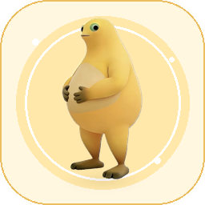

# 奶蛙桌宠 · Naiwa desk pet

一只住在 DeepSeek Harness 窗口里的奶蛙。它会换装、被戳、被投喂，也会跟着你的会话状态认真打工、等你拍板、在任务结束时鼓掌，闲下来还会自己打盹。

> 这是一个 **in-window** 插件，不是独立的 Windows 桌面悬浮窗。它渲染在 DSH Web UI 的 `shell.overlay` 里，随 DSH 页面一起出现。



## 功能

| 交互 | 效果 |
| --- | --- |
| 单击 / `Enter` | 戳一下：奶蛙弹跳、冒爱心、换表情 |
| 拖动 | 任意位置拖动，松手记住位置；位置会随窗口大小自动收回可见区域 |
| 右键 / `Shift+F10` | 打开换装菜单 |
| 方向键 | 每次移动 8px，`Shift` + 方向键移动 24px |
| 右键 → 喂一口 | 吃零食表情 + 碎屑粒子 |
| 右键 → 收起 | 缩成「唤回奶蛙」胶囊；状态不会丢 |

### 六套形象

- **原味**：软乎乎的原版奶蛙。
- **墨镜**：黑超 + 金链，工位最酷的蛙。
- **睡帽**：蓝紫睡帽 + 星星，摸鱼专用。
- **学霸**：圆框眼镜 + 摊开的书。
- **厨师**：白色厨师帽 + 红领巾。
- **魔法**：尖顶巫师帽 + 星星，专治 bug。

换装是即时叠加在原始立绘上的 SVG 图层，不会破坏底图；同一套形象可以和所有表情、状态动画组合。

### 会跟着会话状态变化

插件读取 `shell.overlay` 提供的 `useSessionStatus` 公开快照，只读取运行/等待这类状态，不读取对话内容：

- **打工中**：有会话在运行 → 更快呼吸、蓝色状态点、气泡「认真打工中…」。
- **等你拍板**：有 `pendingInteraction` → 橙色感叹号、微微晃动的担心表情。
- **搞定啦**：从运行变为空闲 → 跳跃庆祝 + 彩纸 + 「搞定啦，给你鼓掌！」。
- **自动打盹**：空闲 2 分钟后打盹，出现 `z z z`；点一下或开始新任务会醒。
- **朝鼠标歪头**：鼠标在窗口里移动时，奶蛙会轻轻朝那个方向偏头；关闭动效后停止。
- **无状态可用**：如果当前 DSH 版本没有提供状态 hook，插件会自动退化成纯桌宠，不会报错。

### 视觉与可访问性

- 浅色/深色主题都使用 DSH 的 `--dsw-alias-*` token。
- 中文/英文文案跟随 DSH 当前语言。
- 支持 `prefers-reduced-motion`，也可以在菜单里手动关闭动效。
- 宠物本体是真实按钮：有 `aria-label`、`aria-haspopup`、`aria-expanded`，菜单打开后焦点落在关闭按钮，`Esc` 关闭。
- 位置、大小、形象、动效、打盹、收起状态保存在浏览器 `localStorage`，不会写入 profile 配置。

## 安装

### 从 GitHub 安装（推荐）

在 DSH 的插件安装界面输入：

```text
github:Skyler-Huang/dsh-plugin-naiwa-pet
```

也可以克隆仓库后，把其中的 `dsh-plugin-naiwa-pet` 目录作为本地 bundle 安装。

### 本机源码

当前工作区里的插件目录：

```text
D:\plugin\dsh-naiwa-pet
```

在 DSH 里通过插件管理器安装本地 bundle，或在设置 → 插件里选择这个目录。安装后如果页面已经打开，刷新一次页面让新的 Client 模块生效。

安装后可以在 `shell.overlay` 中看到 `naiwa-pet`（order 88），与已有的 `whale-pet` 并存。

### 常见问题

- **页面里没出现**：如果页面是在安装前打开的，刷新一次；仍然没有就确认插件已启用，或重启 DSH。
- **和鲸鱼桌宠重叠**：默认位置在鲸鱼左侧；直接把奶蛙拖开，位置会记住。
- **位置跑到屏幕外**：右键 → 归位。
- **想暂时收起来**：右键 → 收起；右下角会出现「唤回奶蛙」。
- **完全停用**：在 DSH 设置 → 插件里停用 `dsh-plugin-naiwa-pet`。

## 开发

```powershell
# 重新生成 client.js（把 WebP 和 CSS 内联进客户端模块）
node tools\build_client.mjs

# 语法检查
node --check client.js
```

源码：

- `src/client.js` — React Client 模块（无 JSX，使用 `React.createElement`）。
- `src/pet.css` — 所有样式，选择器统一以 `.naiwa-` 开头。
- `tools/build_client.mjs` — 把 `assets/naiwa.webp` 与 CSS 内联为 data URI / JSON 字符串。
- `assets/naiwa.webp` — 从工作区 `奶蛙.jpg` 抠图并留出帽子空间后的透明立绘。
- `assets/icon.png` — 插件管理器图标。

## 素材与署名

- 角色「奶蛙」及原始形象：**yugh6 / Naiwa**，<https://github.com/yugh6/Naiwa>。本插件使用工作区中用户提供的 `奶蛙.jpg` 作为本地素材。
- 形象与音效素材的使用请遵循原作者及上游项目的许可（上游为 PolyForm Noncommercial 1.0.0，仅限个人非商业使用）。本仓库不主张角色形象的所有权，也不建议将素材单独再分发或商用。
- 本插件代码：MIT。

灵感参考（功能层面，不包含其代码/素材）：

- [dsh-naiwa-pet](https://github.com/991903428/dsh-naiwa-pet) — 点击互动、托盘、余额卡片、DSH 生命周期。
- [milk-frog-desktoppet](https://github.com/woainiunai/milk-frog-desktoppet) — 眼珠/输入感知、装扮、大小调整。
- [dsh-plugin-whale-pet](https://github.com/Yifffan/dsh-plugin-whale-pet) — `shell.overlay` 内的会话状态桌宠、拖动/收起/主题处理。
